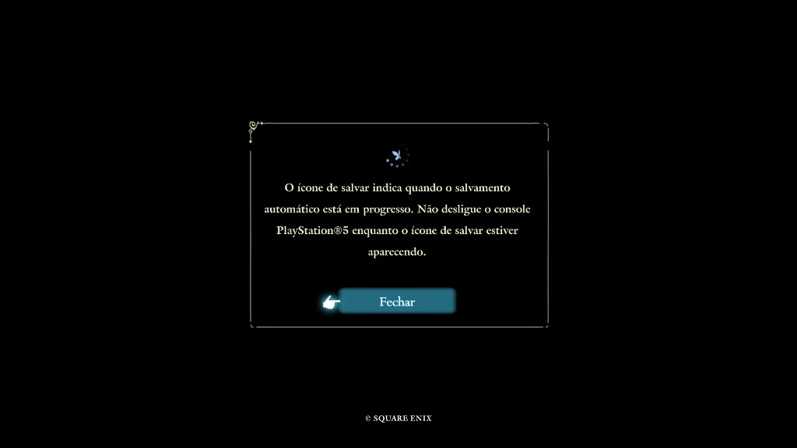
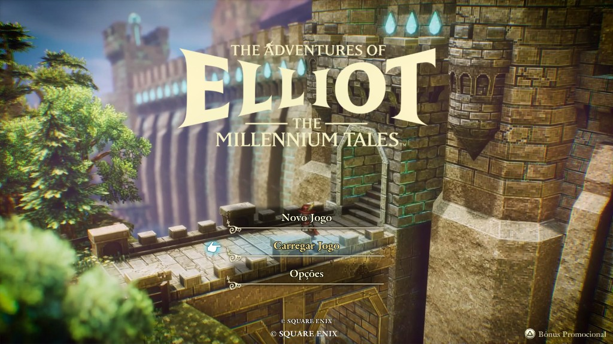
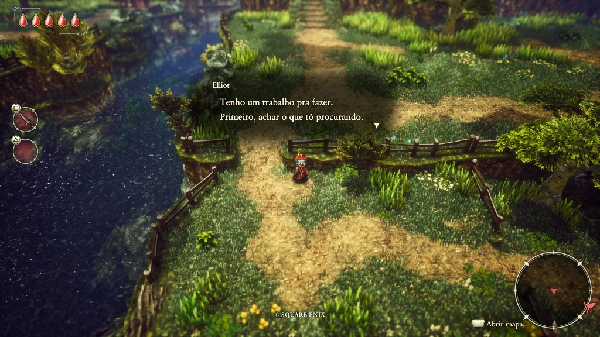

# Tradução PT-BR — The Adventures of Elliot: The Millennium Tales PARA PS5 (PPSA32193)

**Não inclui o jogo.** Só o locres e o script de injeção.

## Screenshots





## Como instalar

### Opção 1 — Exe (recomendado)

Dê dois cliques em `aplicar_traducao.exe` e escolha a pasta `PPSA32193-app0`.

O `.exe` não vai no Git; baixe na [release](https://github.com/samuelrrs/elliot-traducao-pt-br/releases/latest).


### Opção 2 — Python

- **Python 3 instalado no PC.** Baixe em https://www.python.org/downloads/ e, na instalação, deixe marcada a opção **Add python.exe to PATH**. Depois digite no terminal:

```bat
pip install pycryptodome
```

Mantenha juntos: `en-Game.locres.bin`, `aplicar_traducao.py`, `aplicar_traducao.bat` (e o `.vbs`, se vier no zip).

Jeito mais simples: dê dois cliques em `aplicar_traducao.py` (ou no `.vbs`) e escolha a pasta `PPSA32193-app0`.

Também pode arrastar a pasta do jogo em cima do `aplicar_traducao.bat` ou do `.vbs`. A janela fica aberta no final — se fechar sozinha, use o `.py` / `.vbs`.

Se preferir colar o caminho:

```bat
aplicar_traducao.bat "D:\caminho\PPSA32193-app0"
```

## Requisitos do dump

Dump `PPSA32193-app0` (o mesmo do PS5, com `elliot\content\paks\elliot-ps5.pak`, `ampr_emu.index` e `_DUPLEX_\eboot.bin`).

Não funciona colando o pak de PC na pasta de paks. Neste dump o texto tem de ir **dentro** do `elliot-ps5.pak`.

O script faz backup `elliot-ps5.pak.before-pt.bak` **fora** da pasta do jogo (ao lado do `PPSA32193-app0`). Troca o locres e atualiza o `ampr_emu.index`. Se já estiver aplicado, mostra `ja aplicado, nada a fazer`.

🎮 CRÉDITOS E AGRADECIMENTOS

Agradecimentos aos responsáveis pelo material de tradução que serviu de base para este projeto, incluindo o trabalho relacionado à versão disponibilizada pelo grupo Traduções PKG.

Este projeto adapta o material de referência para a versão de PS5. Todos os créditos pelo material original utilizado pertencem aos seus respectivos autores e colaboradores.

